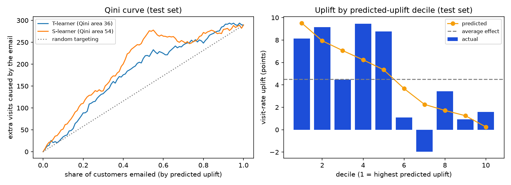

# Customer Intelligence Suite

An online retailer usually wants to know four things about its customers: who they are, what they're worth, who's about to leave, and who's actually worth contacting. I built one model for each question, using two real public datasets, and exported the results as tables for a Power BI dashboard.

1. **Segmentation**: RFM features and K-Means clustering into five customer groups
2. **Customer lifetime value**: MBG/NBD and Gamma-Gamma models predicting each customer's next 12 months
3. **Churn prediction**: XGBoost with SHAP explanations, tested on a later period it never saw
4. **Uplift modelling**: on a randomised email experiment, finding who the email actually persuades

Feature engineering is done in SQL (DuckDB).

## Data

- **[UCI Online Retail II](https://archive.ics.uci.edu/dataset/502/online+retail+ii)** (CC BY 4.0). About 1 million real transactions from a UK online gift retailer, December 2009 to December 2011. Many of its customers are small shops buying wholesale. I use it for segmentation, CLV and churn.
- **[Hillstrom email experiment](https://blog.minethatdata.com/2008/03/minethatdata-e-mail-analytics-and-data.html)** (MineThatData, 2008). 64,000 customers randomly sent a men's email, a women's email, or nothing. Uplift modelling needs a randomised experiment like this, and the retail dataset doesn't have one, so the campaign part uses this dataset.

## Results

### Segments

| Segment | Customers | Last order (median) | Orders (median) | Share of revenue |
|---|---|---|---|---|
| Champions | 467 (8%) | 9 days ago | 23 | 56% |
| Loyal | 1,286 (22%) | 30 days | 8 | 25% |
| New / Promising | 1,129 (19%) | 30 days | 2 | 4% |
| At Risk | 1,335 (23%) | 258 days | 4 | 12% |
| Lost | 1,635 (28%) | 418 days | 1 | 3% |

8% of customers bring in more than half the revenue.

### Lifetime value

I trained on orders up to June 2011 and predicted the next 26 weeks:
- **Order count:** predicted 7,640 against 7,810 actual, a 2% error.
- **Ranking:** the 20% of customers the model ranked highest delivered 73% of the actual revenue.
- **Total revenue:** under-predicted by about 19%. The test window includes Christmas, which is this retailer's peak, and these models have no seasonality. Order counts were right, so the gap comes from larger Christmas order values.

### Churn

Churn here means no order in the next 180 days. I trained on a December 2010 snapshot and tested on June 2011, so the test is on a period the model never saw.

| Model | ROC AUC | Churn rate in top 20% flagged |
|---|---|---|
| Recency only ("days since last order") | 0.765 | 82% |
| MBG/NBD (statistical, no ML) | 0.804 | 82% |
| Logistic regression | 0.792 | 81% |
| XGBoost | 0.799 | 82% |

Every reasonable model ends up around 0.80, which seems to be about as much as purchase history alone can tell you. XGBoost doesn't win on accuracy. I kept it because it gives proper probabilities a retention team can plan with, and SHAP gives each customer their own top three reasons. The biggest drivers are number of orders, days since last order, total spend and the usual gap between orders.

Combining churn risk with CLV picks out **119 customers who are both high-value and high-risk**, with about £226K of expected revenue at stake. That's a realistic call list.

### Uplift

My first choice was the men's email, because it has the larger average effect (+7.7 points of visits). But the effect is almost the same for every kind of customer, so targeting can't do better than emailing everyone. The women's email works well for people who've bought women's products (+7.3 points) and hardly at all for others (+1.1). That variation is what uplift modelling needs, so I switched to it.

- **Emailing only the top 50% by predicted uplift keeps about 89% of the extra visits** for half the emails.
- Customers are split into **Persuadables** (12,808), Sure things, Lost causes, and **Sleeping dogs** (1,361), for whom the email seems to slightly reduce visits.
- The S-learner beat the T-learner on the Qini curve, with an area of 54 against 36.



## How it's built

```
sql/01_clean_transactions.sql   dedupe, drop guest checkouts, fees and postage lines, separate returns
sql/02_orders.sql               lines -> orders, returns, customers
sql/03_customer_features.sql    features as of a cutoff date + churn label (no future data leaks in)
src/build_features.py           runs the SQL in DuckDB at three cutoffs (train / test / today)
src/segment.py                  RFM + K-Means, k chosen by silhouette
src/clv.py                      MBG/NBD + Gamma-Gamma written with scipy, holdout validation
src/churn.py                    4 churn models compared, XGBoost + SHAP reasons
src/uplift.py                   T- and S-learner, Qini curve, uplift groups
src/export_powerbi.py           star-schema tables for Power BI
```

A few decisions worth explaining:

- **Data cleaning.** The raw file has 243K rows with no customer ID, 34K exact duplicates (the two yearly Excel sheets overlap in December 2010), and lines for postage, bank fees and manual adjustments. After cleaning there are 794K product lines, 36.6K orders and 5,852 customers.
- **Testing on the future.** Features are calculated only from data before each cutoff date, and the label comes from the following 180 days. A random train/test split would have let the model learn from the future.
- **MBG/NBD instead of plain BG/NBD.** Plain BG/NBD assumes anyone who has only bought once is still active, even if that purchase was 400 days ago. The modified version fixes this and was just as accurate on the holdout.
- **Gamma-Gamma fitting.** The first fit gave nonsense parameters because the optimiser got stuck. Starting it from several points fixed that. Order value and frequency are almost uncorrelated here (0.02), which is what the model assumes.
- **XGBoost early stopping.** I first stopped on AUC, which was too noisy and stopped after two trees, so I switched to log-loss.

## Limitations

- CLV and churn models don't account for seasonality, so revenue forecasts that include Christmas come out low.
- The churn model slightly over-predicts on the test period, because the training label window (Dec–Jun) had more churn than the test window (Jun–Dec). The final model is retrained on both periods.
- CLV is in revenue, not profit, because margins aren't in the data.
- The uplift results come from a different (US) retailer's experiment, not the UK retailer. They show the method, not a recommendation for this specific business.
- Many customers are wholesalers, so their behaviour is lumpier than a typical consumer brand's.

## Running it

```bash
python3 -m venv .venv
.venv/bin/pip install -r requirements.txt
./run_all.sh
```

`run_all.sh` downloads both datasets, runs the SQL and all four models, and writes the Power BI tables to a local `powerbi/` folder. It takes about 25 seconds.

Built with Python, DuckDB (SQL), pandas, scikit-learn, XGBoost, SciPy, Matplotlib and Power BI.
